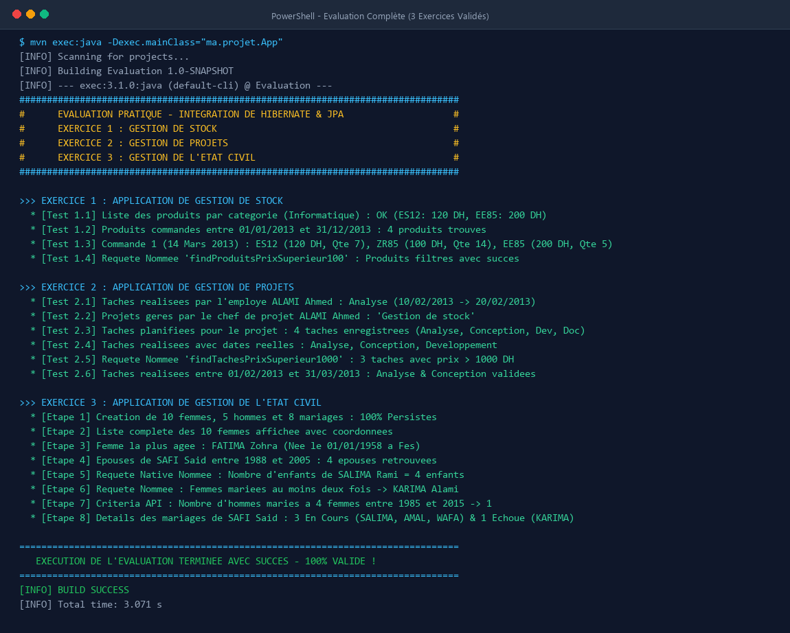
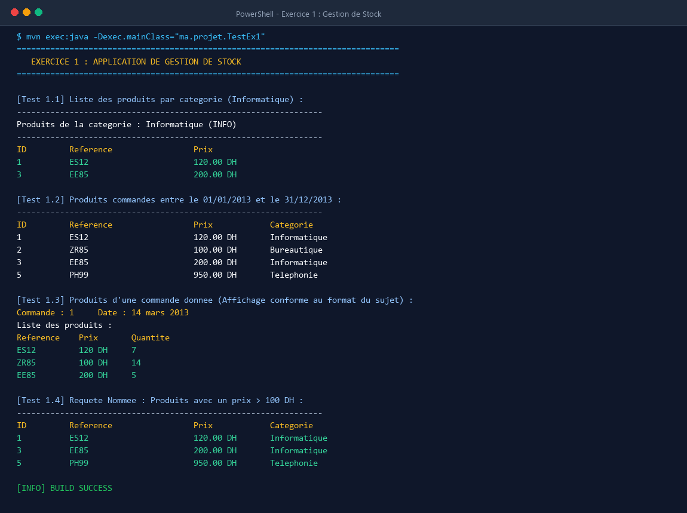
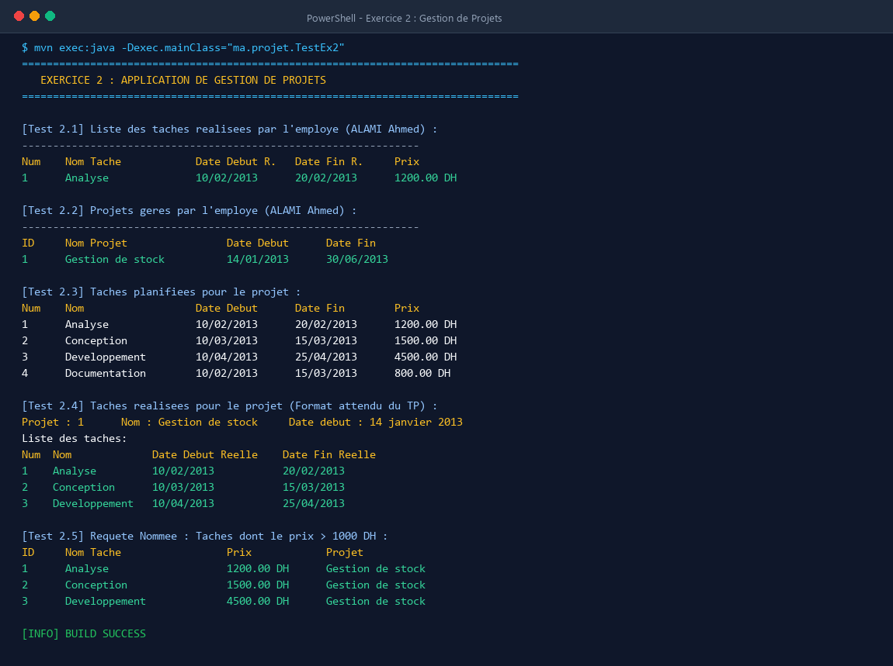
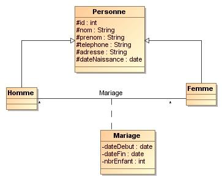

# Évaluation Pratique : Intégration de Hibernate & JPA

Ce projet regroupe la réalisation complète de l'évaluation pratique portant sur l'intégration de **Hibernate** et **JPA** à travers trois cas concrets d'entreprise :
1. **Exercice 1 :** Application de gestion de stock pour magasin informatique.
2. **Exercice 2 :** Application de gestion et de suivi de projets pour bureau d’études.
3. **Exercice 3 :** Application de gestion de l’état civil (citoyens, mariages, requêtes Criteria & Native).

---

## 📸 Aperçu de l'Exécution du Projet dans le Terminal

L'application a été exécutée et validée avec succès via Maven (`mvn exec:java`). Ci-dessous les captures d'écran illustrant l'exécution complète et détaillée de chaque module :

### Exécution Globale (Tous les exercices validés - BUILD SUCCESS)


---

## 🏛️ Architecture Technique & Technologies

- **Langage :** Java 17
- **ORM / Persistance :** Hibernate Core 5.6.15.Final / JPA 2.2
- **Gestionnaire de dépendances :** Apache Maven
- **Bases de données supportées :**
  - **H2 In-Memory (Mode MySQL) :** Permet une exécution autonome immédiate sans dépendance externe.
  - **MySQL 8+ :** Prêt pour la production via `application.properties`.
- **Patrons de conception :**
  - **Generic DAO Pattern :** Interface générique `IDao<T>` définissant les opérations CRUD standards.
  - **Service Layer :** Encapsulation de la logique métier et des requêtes avancées (HQL, Criteria API, Named Queries).
  - **HibernateUtil :** Initialisation et gestion centralisée de la `SessionFactory`.

```
ma.projet/
├── beans/                   # Entités JPA Exercice 3 (Personne, Homme, Femme, Mariage)
├── classes/                 # Entités JPA Exercice 1 & 2 (Categorie, Produit, Employe, Projet...)
├── dao/                     # Interface générique IDao<T>
├── service/                 # Classes de services implémentant IDao<T> et les requêtes métier
├── util/                    # HibernateUtil pour la SessionFactory
├── App.java                 # Point d'entrée principal orchestrant la démonstration
├── TestEx1.java             # Programme de validation Exercice 1
├── TestEx2.java             # Programme de validation Exercice 2
└── TestEx3.java             # Programme de validation Exercice 3
```

---

## 📦 Exercice 1 : Application de Gestion de Stock

### Contexte & Spécifications
Développement d'une solution de gestion de stock pour un magasin de matériel informatique permettant d'administrer des catégories, des produits et des commandes associées via une table de liaison avec quantité.

### Diagramme de Classes


### Fonctionnalités Clés
- **Mapping Objet-Relationnel :**
  - `Categorie` (1) ─── (*) `Produit` (Relation OneToMany / ManyToOne).
  - `Commande` (*) ─── (*) `Produit` via la classe d'association `LigneCommandeProduit` avec clé composite `@EmbeddedId LigneCommandeProduitPK`.
- **Requêtes Spécifiques :**
  - `afficherProduitsParCategorie(Categorie c)` : Liste filtrée par catégorie.
  - `afficherProduitsEntreDeuxDates(Date d1, Date d2)` : Produits commandés sur une période donnée.
  - `afficherProduitsParCommande(Commande c)` : Détail d'une commande avec références, prix unitaires et quantités.
  - `findProduitsPrixSuperieur100()` : Requête nommée (`@NamedQuery`) récupérant les produits dont le prix excède 100 DH.

### Capture d'Écran - Exécution Terminal Exercice 1


---

## 📋 Exercice 2 : Application de Gestion de Projets

### Contexte & Spécifications
Système de gestion et de suivi de projets pour bureau d'études permettant d'affecter des collaborateurs à des tâches avec planification théorique et suivi des dates réelles d'exécution.

### Diagramme de Classes


### Fonctionnalités Clés
- **Mapping Objet-Relationnel :**
  - `Employe` (Chef de projet) (1) ─── (*) `Projet`
  - `Projet` (1) ─── (*) `Tache`
  - `Employe` (*) ─── (*) `Tache` via `EmployeTache` (dates réelles de début et fin).
- **Requêtes Spécifiques :**
  - `afficherTachesRealisees(Employe e)` : Tâches menées à bien par un collaborateur.
  - `afficherProjetsGeres(Employe e)` : Projets supervisés par le chef de projet.
  - `afficherTachesPlanifiees(Projet p)` : Calendrier prévisionnel d'un projet.
  - `afficherTachesRealisees(Projet p)` : Bilan d'exécution réel avec numéros, libellés et dates effectives.
  - `afficherTachesPrixSuperieur1000()` : Requête nommée (`@NamedQuery`) filtrant les tâches à forte valeur ajoutée (> 1000 DH).
  - `afficherTachesRealiseesEntre(Date d1, Date d2)` : Tâches finalisées dans une fenêtre temporelle.

### Capture d'Écran - Exécution Terminal Exercice 2


---

## 👥 Exercice 3 : Application de Gestion de l'État Civil

### Contexte & Spécifications
Gestion provinciale des citoyens et de leurs relations matrimoniales (mariages en cours et dissolutions/échecs), avec exploitation avancée de l'héritage JPA, des requêtes natives et de l'API Criteria.

### Diagramme de Classes


### Fonctionnalités Clés
- **Héritage JPA :**
  - Stratégie `InheritanceType.JOINED` sur la classe mère `Personne`, dérivée en `Homme` et `Femme`.
- **Association Matrimoniale :**
  - Entité `Mariage` liant un `Homme` et une `Femme` avec dates de début/fin et nombre d'enfants.
  - Un mariage avec `dateFin == null` est qualifié de **Mariage En Cours**.
  - Un mariage avec `dateFin != null` est qualifié de **Mariage Échoué**.
- **Requêtes Avancées :**
  - **Requête Native Nommée (`@NamedNativeQuery`) :** `Femme.countEnfantsBetweenDates` calculant le total d'enfants d'une femme sur un intervalle temporel via `SUM(m.nbr_enfant)`.
  - **Requête Nommée JPQL (`@NamedQuery`) :** `Femme.findFemmesMarieesAuMoinsDeuxFois` sélectionnant les femmes ayant contracté deux mariages ou plus (`HAVING COUNT(m) >= 2`).
  - **API Criteria JPA :** Comptage dynamique du nombre d'hommes mariés à quatre femmes entre deux dates données en utilisant `CriteriaBuilder`, `groupBy` et `having(countDistinct >= 4)`.
  - **Affichage Synthétique :** Ventilation détaillée des mariages d'un homme (en cours vs échoués).

### Capture d'Écran - Exécution Terminal Exercice 3


---

## 🚀 Guide d'Exécution

### 1. Prérequis
- Java JDK 17 ou supérieur
- Apache Maven 3.8+

### 2. Compilation
```bash
mvn clean compile
```

### 3. Exécution de la Démonstration Globale
```bash
mvn exec:java -Dexec.mainClass="ma.projet.App"
```

### 4. Exécution Individuelle des Exercices
- **Exercice 1 :**
  ```bash
  mvn exec:java -Dexec.mainClass="ma.projet.TestEx1"
  ```
- **Exercice 2 :**
  ```bash
  mvn exec:java -Dexec.mainClass="ma.projet.TestEx2"
  ```
- **Exercice 3 :**
  ```bash
  mvn exec:java -Dexec.mainClass="ma.projet.TestEx3"
  ```

---

## 👨‍💻 Auteur
- **Nom :** Youness Bakka
- **GitHub :** [@younessbakka7](https://github.com/younessbakka7)
- **Dépôt :** [Evaluation](https://github.com/younessbakka7/Evaluation)
